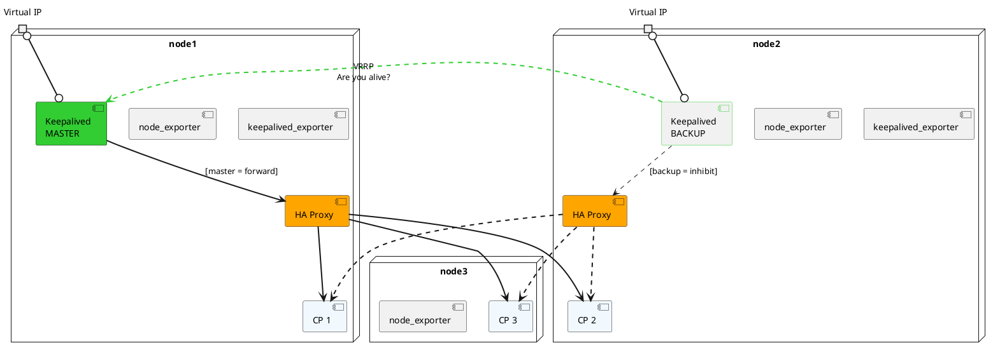
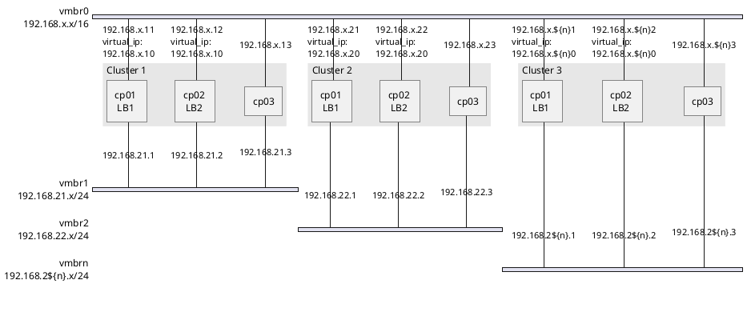

# k3prox

Provision multiple/isolated k3s clusters on Proxmox. I came across the need while teaching, for I needed all my student to have their own HA kubernetes clusters on pretty unstable Proxmox servers without needing to reinstall it manually. Clusters are isolated from one another, except for the Load balancers living on **vmbr0**.

## Architecture

**vmbr0** exposes the ssh servers of the nodes together with the **virtual ip** used by the load balancers. Node communication occurs through **vmbr1** (resp. vmbr2, vmbr3, *etc*), leaving **vmbr0** only for vertical communication



Up to 25 clusters can be instanciated with this repository. Nodes are all Alpine Linux **control planes** entirely provisioned with the ansible playbook. All three expose their metrics with a [node_exporter](https://github.com/prometheus/node_exporter) while node1 and node2, assuming the role of **load balancers**, also expose a [keepalived_exporter](https://github.com/mehdy/keepalived-exporter). Ports for the metrics

* 9100: node_exporter
* 9101: haproxy_exporter
* 9102: keepalived_exporter

Vlans are determined solely by the cluster numerical ID. 




## Usage

In `./environments`, create `./environments/cluster_1/cluster.tfvars` following the provided example. Then, from `./environments/cluster_1/`, 

```bash
tofu init

tofu apply --var-file ./cluster.tfvars
```

And, in a few minutes, you should have a kubernetes cluster. For multiple clusters, replicate `./environments/cluster_1`, edit its var-file and apply the same method

To remove a cluster from Proxmox, simply

```bash
tofu destroy --var-file ./cluster.tfvars
```

from the corresponding environment folder


